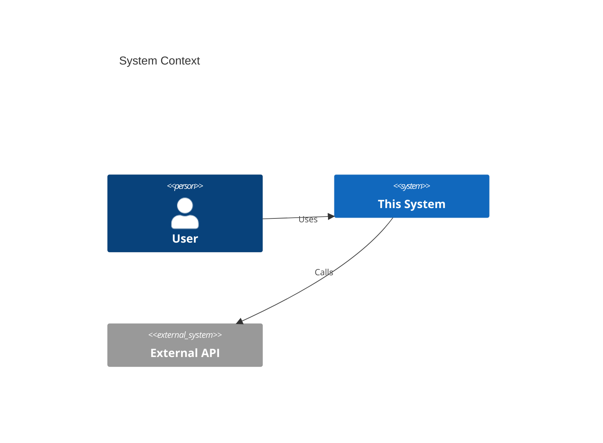

# Analysis playbook

Techniques for each documentation area. Adapt to the detected stack.

## Recon quick commands

```bash
# Top-level layout
ls -la
find . -maxdepth 3 -type f \( -name 'README*' -o -name 'Dockerfile*' -o -name 'docker-compose*.yml' -o -name '*.sln' -o -name 'package.json' -o -name 'go.mod' -o -name 'pom.xml' -o -name 'pyproject.toml' -o -name 'Cargo.toml' \) 2>/dev/null

# Entrypoints / hosts
rg -n "WebApplication\.Create|Map(Get|Post|Put|Delete)|app\.(get|post)|@app\.(route|get)|func main\(|SpringBootApplication" --glob '!**/node_modules/**' --glob '!**/bin/**' --glob '!**/obj/**'

# Auth hints
rg -n "Authorize|AddAuthentication|JWT|OAuth|OIDC|ApiKey|Bearer|passport|session" --glob '!**/node_modules/**'

# Data access
rg -n "DbContext|EntityFramework|mongoose|prisma|typeorm|sequelize|SqlConnection|CREATE TABLE|Flyway|Liquibase|Migration" --glob '!**/node_modules/**'

# Messaging
rg -n "Kafka|RabbitMQ|ServiceBus|SQS|NATS|MassTransit|IHostedService|@EventPattern" --glob '!**/node_modules/**'

# TODO / debt
rg -n "TODO|FIXME|HACK|XXX|DEPRECATED" --glob '!**/node_modules/**' --glob '!**/bin/**' | head -200
```

Prefer the workspace `Grep`/`Glob`/`Task(explore)` tools over dumping huge trees into chat.

## Context & purpose

| Artifact | Sources |
|----------|---------|
| Vision | Root README, product docs, issue templates, UI copy, domain folder names |
| Glossary | Entity classes, DB tables, API resource names, enums, bounded-context folders |
| Stakeholders | CODEOWNERS, package.json `author`, Azure/DevOps owners, README contacts, git shortlog |

Git hint for ownership density:

```bash
git shortlog -sn --all | head -20
ls -la CODEOWNERS .github/CODEOWNERS 2>/dev/null
```

## Architecture (C4)

1. **L1 System context:** actors (users/roles) + external systems from HTTP clients, SDKs, connection strings, env templates.
2. **L2 Containers:** each deployable (web, API, worker, DB, cache, queue). Map from Docker Compose services, solution projects, K8s deployments, publish profiles.
3. **L3 Components:** inside each container — controllers/services/repositories/modules. One component diagram per major container; skip trivial libs.
4. **ADRs:** look for `docs/adr`, `ADR-*.md`, Nygard format. If absent, draft **candidate ADRs** from strong signals (chosen framework, auth mode, DB) tagged `inferred`.
5. **Module map:** annotate top 2–3 directory levels; link to projects/packages.

Mermaid C4-ish context example:



If C4 Mermaid is unsupported in the host renderer, use plain `flowchart`/`graph TB`.

## Dependencies

| Stack | Inventory command |
|-------|-------------------|
| Node | `npm ls --all` / read lockfile; licenses via `npx license-checker --summary` (ask before install) |
| .NET | `dotnet list <sln> package --include-transitive` |
| Python | `pip freeze` / `uv pip compile` / poetry export |
| Go | `go list -m all` |
| Java | `mvn dependency:tree` / `gradle dependencies` |
| SBOM | `syft` or `npx @cyclonedx/cdxgen` → `dependencies/sbom.cdx.json` |

Criticality heuristic: runtime auth/DB/web framework = **critical**; test/lint only = **dev**; unused/transitive deep = note in SBOM summary.

External services: scan env samples (`*.env.example`, `appsettings*.json`, Helm values) for URLs/hosts; document auth scheme from client code.

## Data

1. Prefer schema sources of truth: EF migrations, Prisma schema, SQL DDL, Liquibase/Flyway, Doctrine.
2. Build ERD in Mermaid `erDiagram`.
3. Data dictionary: one row per important column (name, type, nullability, meaning, PII?).
4. Data flow: request → validation → domain → persistence → integrations; mark PII fields and retention if evidenced.
5. Migration history: list migration files chronologically + current head.
6. **Table fill sources** (required when any DB/store exists) → write `data/table-fill-sources.md`:
   - Inventory every table/collection/view referenced in app code (SQL strings, ORMs, typed DataSets, repositories, migrations).
   - For each object, search for write evidence: `INSERT` / `UPDATE` / `DELETE` / `MERGE` / `UPSERT`, ORM `SaveChanges`/`Add`/`Update`/`Remove`, write stored-proc calls, seeders, ETL jobs in-repo.
   - Classify **Filled by this system?** as:
     - **Yes** — this codebase issues DML or a named write SP/job
     - **No** — only reads (`SELECT` / joins / queries); fill method unknown (DBA/manual/other system)
     - **Likely** — write path inferred (e.g. SP family, parallel `*2` tables) but SP/job body not in repo
   - Cite file:line (or SP name + call site). Group by domain area.
   - Separate section for write stored procedures / jobs whose bodies are not in the repo (likely targets + call sites).
   - List views/read-models separately (not base fill inventory).
   - Document limits: missing schema scripts, live-DB-only tables, SP bodies out of repo.
   - Summary counts: Yes / No / Likely.
   - If no persistence layer: write `N/A — no database or durable store evidenced` with confidence.

## Behavior & logic

1. Pick 3–7 critical journeys from UI routes, API controllers, or README.
2. Sequence diagrams from controller → service → repo → external call.
3. State machines from status enums + transition methods.
4. Business rules: validation attributes, domain methods, policy classes, magic constants — explain *why* when comments/tests reveal intent.
5. API: export/link OpenAPI; else table of method, path, auth, request/response, errors.
6. Events: publishers/consumers, topic names, payload types; write `N/A — not event-driven` if none.
7. **Required document uploads:** [reviews/required-document-uploads.md](reviews/required-document-uploads.md). Write `behavior/required-document-uploads.md`. List only required, visible upload fields, with the form title, the flow, the document label, and the intention taken from the form. If there is no user form, write `N/A`.

## Operations

| Topic | Sources |
|-------|---------|
| Deploy | Docker/K8s/Terraform/pubxml/pipelines, hosting docs |
| Runbook | ops docs, pipeline rollback jobs, health endpoints |
| Config | env examples, `IConfiguration`, feature flag libs |
| Observability | OpenTelemetry, AppInsights, Serilog/sinks, Grafana dashboards, health routes. Write the Gaps section per [reviews/observability.md](reviews/observability.md) |
| CI/CD | workflow YAML stages: build → test → scan → deploy |

## Quality & security

- Tests: locate `*Test*`, `*.spec.*`, coverage config; summarize layers (unit/integration/e2e) and gaps.
- **Maintainability:** follow [maintainability.md](maintainability.md). Run `ensure-maintainability-tools.sh` (no `--install`). If tools are missing, ask; install only after the user agrees; then `run-maintainability.sh` and write `maintainability-analysis.md`. Feed P1 hotspots into the tech-debt register.
- Threat model: entrypoints, authn/z, trust boundaries, injection sinks, secrets handling, dependency risk from SBOM. Link the authentication and access-control pages from the auth section.
- **Authentication:** [reviews/authentication.md](reviews/authentication.md). Write `quality-security/authentication.md`. Record the mechanism the code calls. Name a provider only when the code names it.
- **Access control:** [reviews/access-control.md](reviews/access-control.md). Write `quality-security/access-control.md`. Grade None / Weak / RBAC / ABAC from the checks in this tree.
- **User interface:** [reviews/ui.md](reviews/ui.md). Write `quality-security/ui.md`. One row per user surface. Name a design system only when the code references it.
- Debt: TODO/FIXME, deprecated APIs, ignored tests, pinned old frameworks.

## Onboarding

- Local setup: exact commands that work in *this* environment when possible; otherwise document required services (DB versions, etc.) as `UNKNOWN` with placeholders.
- Contribution: CONTRIBUTING.md, branch naming in CI, linters/formatters, PR template.
- Start-here: index + reading order (context → architecture → local setup → deepen). Include `authentication.md`, `access-control.md`, and `ui.md` in the quality index.
- Root README: after gap review, write `README.md` from [templates/root-readme.md](templates/root-readme.md). Say what the repository is and what it does. Do not write a verdict.
- Codebase paths in every section: relative markdown links, link text from the repo root, target from the doc file. See [doc-outline.md](doc-outline.md#codebase-references).
- Footers: after the section files exist, end each of them with a link to `00-start-here.md` and links to the other markdown files in that same directory. See [doc-outline.md](doc-outline.md#document-footers). Do not chain previous/next across sections.
